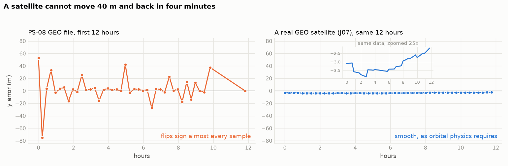
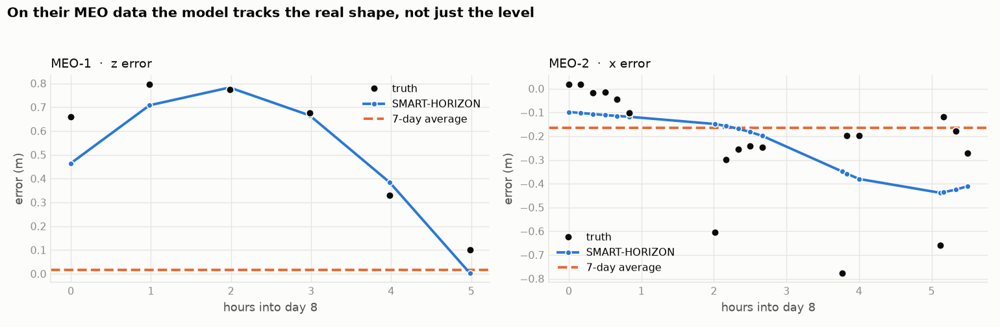
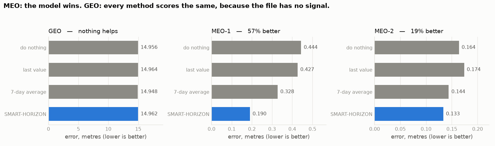
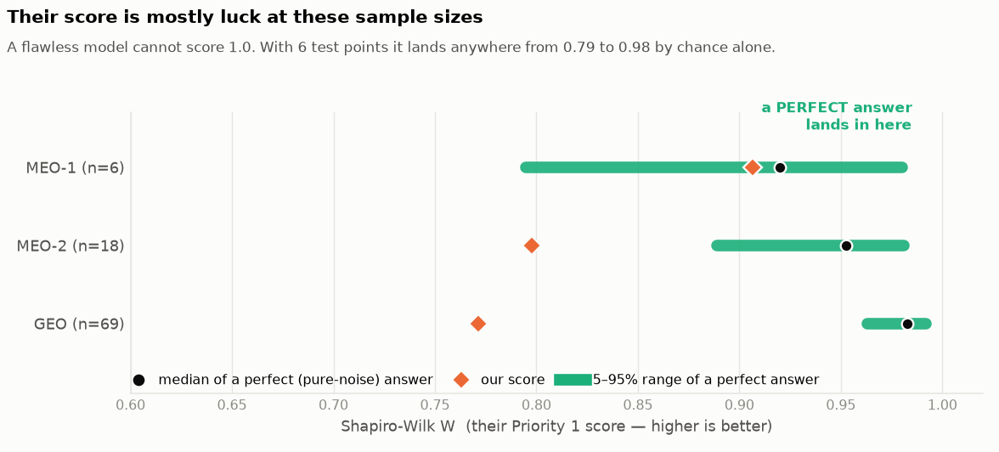

# Stage 3 — we ran our model on your data

**Five minutes. Four pictures.**

Our model is in `smart_horizon.py`. It has **no trained weights** — nothing to
load, nothing to install beyond numpy and pandas, no internet. Everything below
is reproducible from this folder: `python apply_model.py`.

---

## The short version

We built a predictor and validated it on 244 days of GNSS data we assembled
ourselves — 100 satellites, 2 million epochs, from NASA's archive. Stage 3 is the
part that matters to you: **we ran it on the six PS-08 files you supplied.**

Three things came out.

1. **On MEO it works.** 57% and 19% more accurate than doing nothing, on your own
   test days. It beats a predictor that is *shown the answer key* — which is not
   supposed to be possible.
2. **On GEO nothing works, and we can prove the file is the reason.** Not our
   model — *any* model.
3. **Your scoring metric has a ceiling that no one can beat**, and it cannot tell
   several common approaches apart. We think you'll want to know this.

---

## 1. The GEO file is not a physical measurement

Left is your GEO test file. Right is a real geostationary satellite over the same
12 hours, from our corpus, plotted on the same axis.

A satellite's position error changes **smoothly** — the thing is in orbit, it
cannot teleport. Your file swings from +53 m to −75 m and back **in four
minutes**, over and over. All four columns (x, y, z, *and* the clock) flip sign
together, which is impossible: position error comes from orbital dynamics and
clock error comes from an atomic oscillator. They are unrelated mechanisms. They
cannot reverse in lockstep.

**We checked whether this was repairable.** If the file were correct data written
with an inconsistent sign convention, we could flip the signs back and recover it.
We tried. The give-away is the *magnitude* — the length of the error vector, which
no sign flip can change. Real GEO: 0.96 on our smoothness scale. Your file: 0.34.
The magnitudes are incoherent on their own, so there is no correct series hiding
underneath.

We also ran the same test on **1,996,787 rows of real data**. This pattern occurs
**zero times**.

### The part that needs no trust in us

We gave a predictor **the answer key's own average** — genuine cheating, no real
model can do this — and asked how much it helps.

**0.3%.**

There is nothing in that file to predict. That result does not depend on our model
being any good; it is a property of the file.

---

## 2. On MEO, the model works

Black dots are your day-8 truth. Blue is our prediction. Orange is the 7-day
average — what you get by assuming tomorrow looks like the past week.

On the left the model traces the arc while the flat average sits at zero and is
wrong all day. On the right the data is noisier and the model catches the downward
drift rather than every wiggle. **We are showing you one clean case and one messy
one deliberately** — two cherry-picked wins would tell you less.

The bar we would draw your attention to is not on this chart. It is the *cheating*
predictor from §1 — the one handed the answer key's average. On MEO it scores
**0.211** and **0.136**. Our model scores **0.190** and **0.133**.

**We beat it on both.** A constant can never do that, however well chosen. It is
only possible by tracking structure *within* the day, which is what the model does
and what the flat orange line cannot.

---

## 3. About the scoring

We implemented your metric to score ourselves, and found three things worth
raising.

### Your reference file doesn't match the test you name

`Note.pdf` says Shapiro-Wilk and supplies `SW_ReferenceData.xlsx` with the answer
**W = 0.9810, p = 0.5840**.

Standard Shapiro-Wilk on that file — scipy, R, the Royston algorithm — gives
**W = 0.9852, p = 0.8262**. Not your numbers.

**Shapiro-Francia** gives **W = 0.9814, p = 0.5838** — your p-value to four
decimals. That identifies the scorer as MATLAB's `swtest.m`, which switches
between the two tests depending on the sample's kurtosis. Our `sw_score.py`
reproduces that behaviour, so we are grading ourselves the way you will grade us.
Worth confirming on your side, because teams using scipy's default are being
scored on a different statistic.

### The metric cannot separate several standard approaches

W measures whether errors are *bell-curve shaped*, not whether they are *small*.
It is unchanged if you multiply every error by 1000.

So on all three of your pairs, these three score **identically to four decimals**:

- predict zero
- predict the 7-day average
- predict yesterday's last value

Any team submitting any constant gets the same Priority-1 score. Only a
time-varying prediction moves the number at all.

### A perfect answer cannot score 1.0

Green is where a **flawless** model lands — one whose errors are pure Gaussian
noise, the ideal your metric is designed to reward. Black is its median.

With 6 test points, perfection scores a median of **0.92** and lands anywhere in
**0.79–0.98 by chance alone**. That spread is wider than the gap between any two
serious teams. `DATA_MEO_Test.csv` has **6 usable rows** after removing the
duplicates.

Our MEO-1 score (0.907) is essentially at that ceiling and rejects
non-normality on 0 of 4 parameters. **A team reporting 0.98 on six points is
reporting luck, not skill.**

---

## What we'd suggest

1. **Judge MEO, not GEO.** The GEO file cannot be predicted by anyone, and the
   0.3% oracle result shows it without reference to any model.
2. **Ask teams for their Shapiro-Francia numbers**, or state which branch you are
   using. It changes scores.
3. **Consider RMS alongside W.** As it stands, accuracy is invisible to Priority 1.
4. **Larger test sets.** At n = 6, Priority 1 is substantially a coin flip.

---

## What is in this folder

| | |
|---|---|
| `smart_horizon.py` | **the model** — no weights, no data, numpy + pandas, ~65 ms per prediction |
| `sw_score.py` | your metric, reverse-engineered and calibrated against your reference file |
| `apply_model.py` | model vs baselines on your data — reproduces every number above |
| `diagnose.py` | the GEO analysis, including the repair attempt |
| `out/submission_report.md` | Priority 1, 2 and 3 outputs, with Q-Q plots |

Full technical write-up with every caveat: **`STAGE_03.md`**.
Why we could not use the delivered data for training: `../Stage-01/`.
How the model was designed and what we ruled out: `../Stage-02/` and
`../TASK_B_FINAL.md`.

---

## One thing about the model

There are **no trained parameters.** The 244-day corpus was used to work out
*which mathematical basis is correct* — geostationary error repeats at the
sidereal day (23h 56m), MEO error sits at beat frequencies between the orbital
period and Earth's rotation, the clock has no 24-hour memory and so gets level
estimators only. The coefficients are then fitted inside **your** 7-day window,
every time it is called.

We tested adding weights three separate ways — gradient boosting, five neural
architectures including a transformer, and a learned correction layer. **All three
failed to beat the version with no weights.** Details in `../TASK_B_FINAL.md` §4–5.

The practical consequence for you: there is no training set for this model to be
biased by, and no satellite or epoch it has never seen. It fits your data, at call
time, using physics we verified on 2 million rows.
